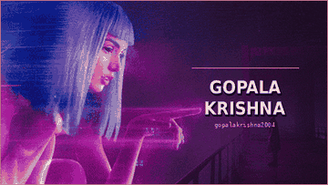

 

### `GOPALA KRISHNA`
**Developer · Builder · Curious by default**

 

## TRANSMISSION / 001

Hey, I'm **Gopala Krishna**.

I enjoy turning ideas into useful digital experiences, learning how things work, and building projects one thoughtful step at a time.

This profile is a small window into what I'm learning and making. Stay a while.

## CURRENTLY IN THE WORKSHOP

A couple of personal projects are taking shape. I'll add their full showcases here once their public repository links and project visuals are ready.

## GITHUB SIGNAL

## CONTRIBUTION TRACE

## COLOUR FREQUENCY

---

*“Somewhere, something incredible is waiting to be known.”*

GOPALA KRISHNA · END OF TRANSMISSION

