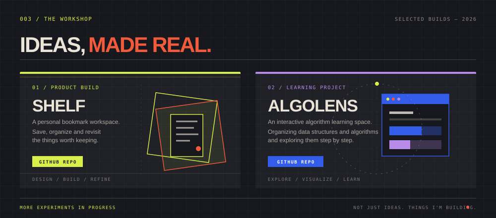
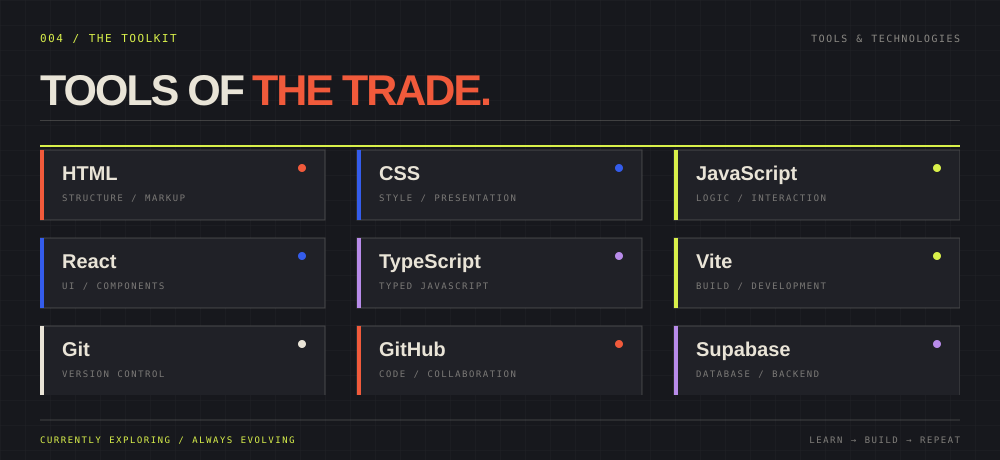

<!-- ===================================================== -->
<!-- HERO -->
<!-- ===================================================== -->

  

 

**DEVELOPER · BUILDER · CURIOUS BY DEFAULT**

---

<!-- ===================================================== -->
<!-- 001 / TRANSMISSION -->
<!-- ===================================================== -->

  

<!-- ===================================================== -->
<!-- 002 / CURRENTLY EXPLORING -->
<!-- ===================================================== -->

  

<!-- ===================================================== -->
<!-- 003 / THE WORKSHOP -->
<!-- ===================================================== -->

  

&nbsp;&nbsp;

 

<!-- ===================================================== -->
<!-- 004 / THE TOOLKIT -->
<!-- ===================================================== -->

  

 

<!-- ===================================================== -->
<!-- 005 / GITHUB ACTIVITY -->
<!-- ===================================================== -->

<!-- 005 / GITHUB ACTIVITY -->
<h2>005 / GITHUB ACTIVITY</h2>

  <!-- GitHub Statistics -->

  <!-- Most Used Languages -->

  

  <!-- Contribution Streak -->

  

  <!-- Contribution Snake -->

---

<!-- ===================================================== -->
<!-- FOOTER -->
<!-- ===================================================== -->

**BUILDING · LEARNING · EXPERIMENTING**

GOPALA KRISHNA / END OF TRANSMISSION

